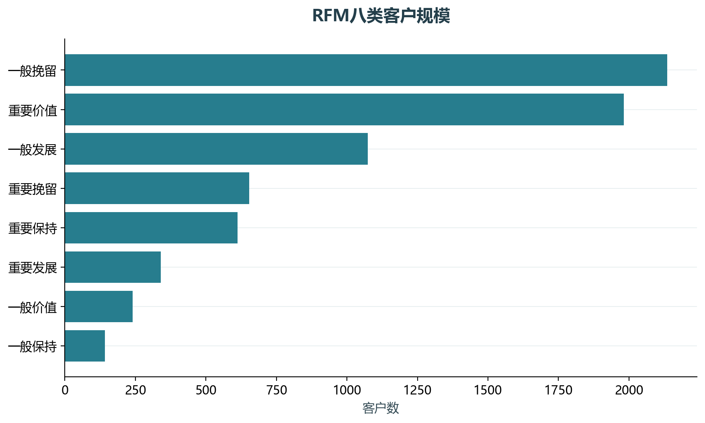
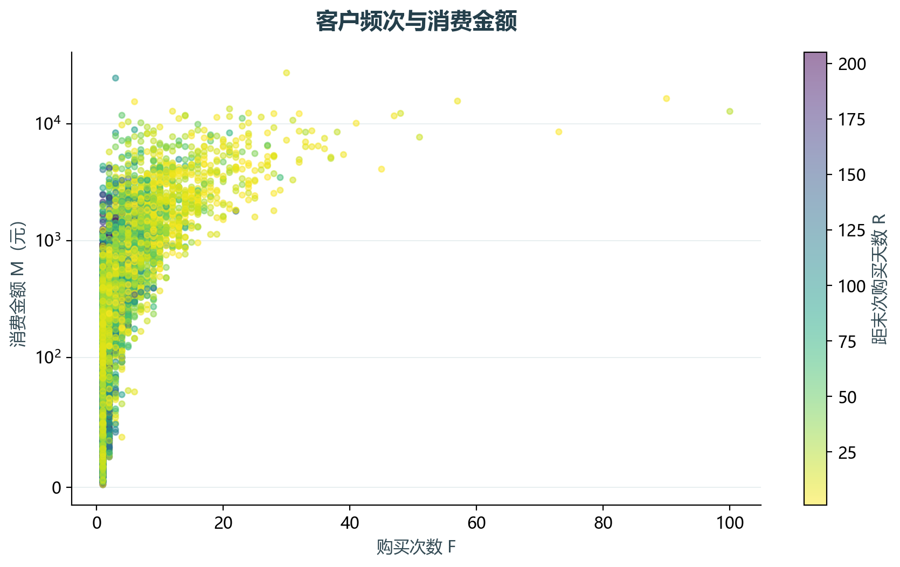

# 实验01 RFM客户价值

客户价值不是单次客单价。此实验先把商品明细聚合成订单，再由最近购买间隔R、独立流水号数F和金额M描述客户。

## 思路与参数

以最后销售日后一天为参照日；R低更活跃，F和M高表示频繁或高额购买。用全体客户中位数划分八类，等于阈值的边界处理在代码中写明。

## Python转换

把Excel的分组、条件判断和分类图迁移为groupby、布尔编码及Matplotlib；未复制已有Excel图表。

运行本目录的`python 实验.py`，或在商业数据分析根目录运行`python run_all.py --only 01`。输入取自同目录data，结果写入outputs。

## 实际结果

由65989条商品明细汇总出26735笔订单、7178位客户。规模最大的类别为“一般挽留”，分类阈值见results.json。

完整数值见[results.json](outputs/results.json)，中间表和预测结果见[outputs](outputs/)。

## 教材定位

来源：`CDA 教材资料2025.zip`。源文件路径及SHA-256见[全局来源清单](../../sources.json)。

- `CDA 教材资料2025/1《CDA 一级认证教材：商业数据分析》/第2章 数据分析方法/1、分析的基础范式/data-无答案/1-2RFM模型.xlsx`
