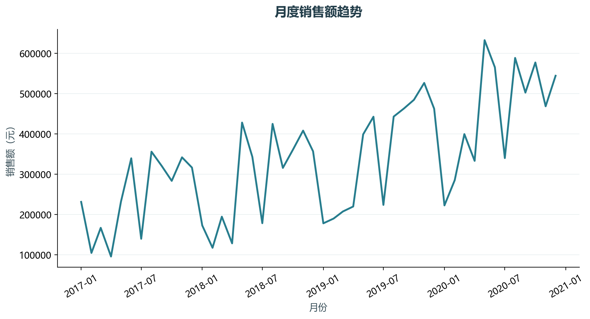
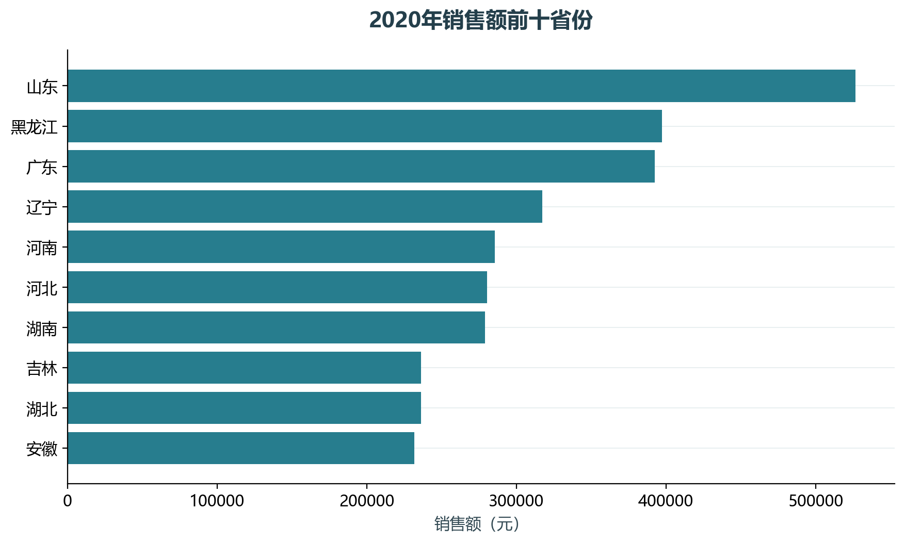

# 实验02 收入趋势与结构

经营收入的增长需要同时查看时间变化和地区结构。本实验按年月汇总销售额，再查看最后一年各省份的贡献。

## 思路与参数

月度同比按相隔12个月计算，首年没有基期的月份保留空值；省份前十只用于图形，完整地区表仍然导出。

## Python转换

把教材收入分析的透视汇总和趋势图改为Pandas日期聚合、同比计算及横向排名图。

运行本目录的`python 实验.py`，或在商业数据分析根目录运行`python run_all.py --only 02`。输入取自同目录data，结果写入outputs。

## 实际结果

覆盖48个月，2020年销售额最高的省份为山东，占该年销售额的9.64%。

完整数值见[results.json](outputs/results.json)，中间表和预测结果见[outputs](outputs/)。

## 教材定位

来源：`CDA 教材资料2025.zip`。源文件路径及SHA-256见[全局来源清单](../../sources.json)。

- `CDA 教材资料2025/1《CDA 一级认证教材：商业数据分析》/第3章 商业数据分析框架/案例1：收入趋势分析/案例1：收入趋势分析原始数据.xlsx`
