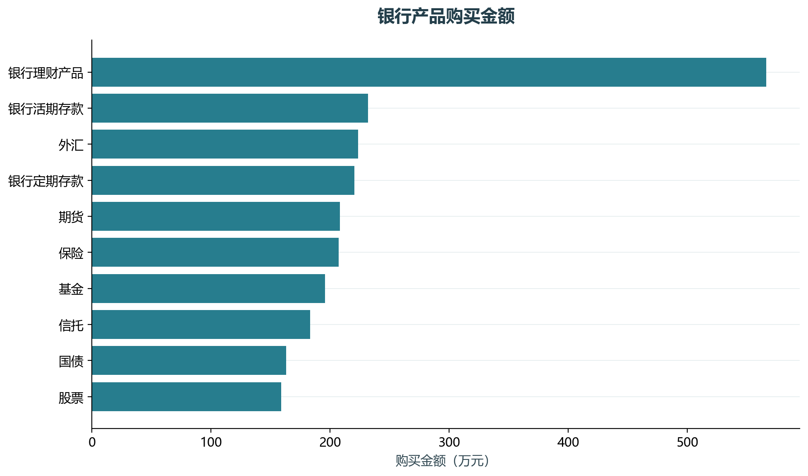
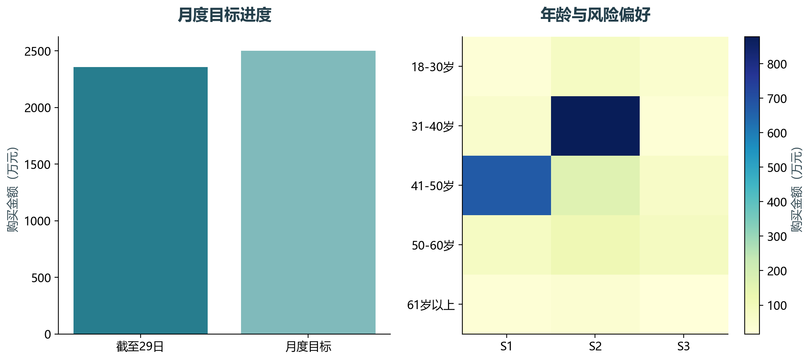

# 实验03 银行经营看板迁移

本实验将银行理财经营看板拆成产品销售、客群结构与月度目标进度。贷款渠道属于另一份业务表，单独汇总。

## 思路与参数

教材背景给出月目标2500万元、当前29日、全月31日。线性进度估计不考虑月底活动，属于情景测算，不冒充统计预测。

## Python转换

PowerBI的维度关系由many_to_one合并替代；分组矩阵、进度柱形和客群热图由Python生成。两份业务表没有可核验客户键，未强行拼接。

运行本目录的`python 实验.py`，或在商业数据分析根目录运行`python run_all.py --only 03`。输入取自同目录data，结果写入outputs。

## 实际结果

理财购买记录440条，购买金额合计2358.44万元，月目标完成率94.34%。若目标不变，剩余两日平均每天需完成70.78万元。

线性进度只是情景测算；贷款申请与理财销售没有可核验主键，分别汇总。

完整数值见[results.json](outputs/results.json)，中间表和预测结果见[outputs](outputs/)。

## 教材定位

来源：`CDA 教材资料2025.zip`。源文件路径及SHA-256见[全局来源清单](../../sources.json)。

- `CDA 教材资料2025/1《CDA 一级认证教材：商业数据分析》/第5章 业务数据分析/第5章  PowerBI业务看板案例-银行案例/银行案例数据 - 学员用.xlsx`
- `CDA 教材资料2025/1《CDA 一级认证教材：商业数据分析》/第5章 业务数据分析/第5章 WPS归因分析案例-银行案例/归因分析数据.xlsx`
