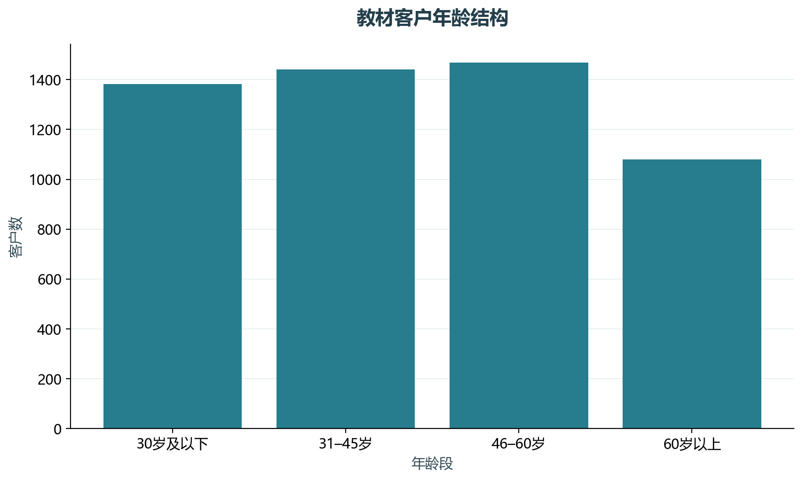
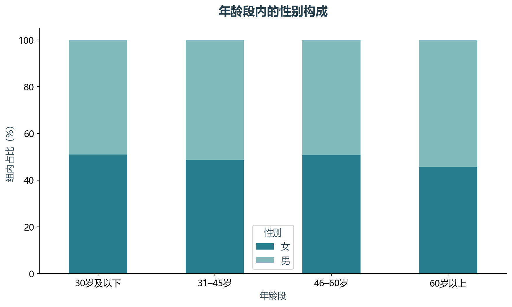

# 实验04 SQL客户画像

同一客户可能对应多个账户，连接后直接计数会重复。本实验用客户表、账户持有人关系和贷款表构建客户粒度画像。

## 思路与参数

SQLite执行LEFT JOIN及COUNT(DISTINCT)，保留无账户客户；年龄以1998年12月31日为教材历史参照，不套用今天的年龄。

## Python转换

把教材的MySQL查询思路迁移到Python内置SQLite，源SQL也会输出。仅账户所有者用于本人账户与贷款标记。

运行本目录的`python 实验.py`，或在商业数据分析根目录运行`python run_all.py --only 04`。输入取自同目录data，结果写入outputs。

## 实际结果

客户画像保留5369位客户，其中4500位为账户所有者，682位存在贷款关联。多表连接没有把客户数放大。

画像采用教材历史截止日；不将关系表连接后的重复行当作独立客户。

完整数值见[results.json](outputs/results.json)，中间表和预测结果见[outputs](outputs/)。

## 教材定位

来源：`CDA 教材资料2025.zip`。源文件路径及SHA-256见[全局来源清单](../../sources.json)。

- `CDA 教材资料2025/1《CDA 一级认证教材：商业数据分析》/第9章 用户标签体系与用户画像专题/data/accounts.csv`
- `CDA 教材资料2025/1《CDA 一级认证教材：商业数据分析》/第9章 用户标签体系与用户画像专题/data/clients.csv`
- `CDA 教材资料2025/1《CDA 一级认证教材：商业数据分析》/第9章 用户标签体系与用户画像专题/data/disp.csv`
- `CDA 教材资料2025/1《CDA 一级认证教材：商业数据分析》/第9章 用户标签体系与用户画像专题/data/loans.csv`
- `CDA 教材资料2025/1《CDA 一级认证教材：商业数据分析》/第9章 用户标签体系与用户画像专题/data/district.csv`
