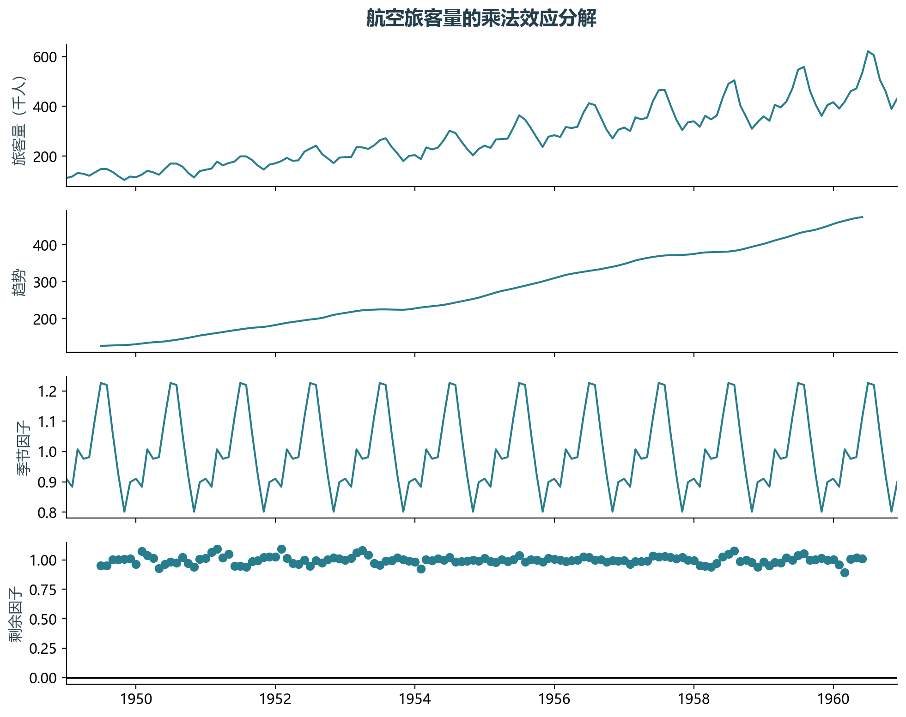
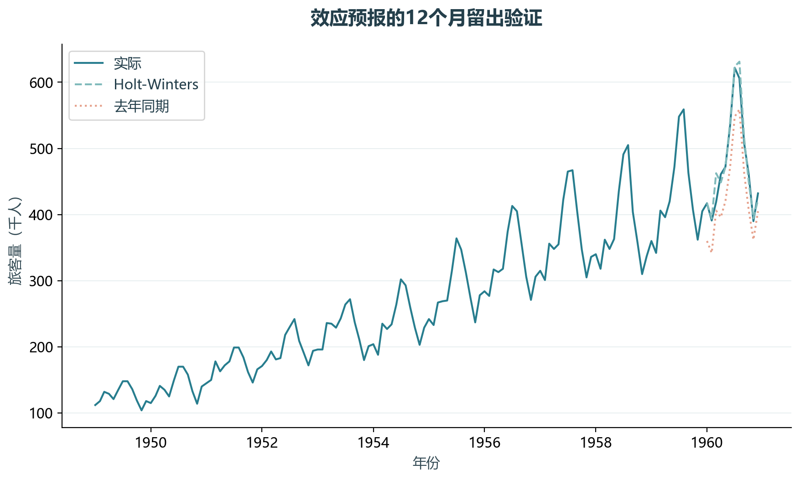

# 实验05 效应分解预报

航空旅客量既有增长趋势，也有年度季节性。实验将趋势、季节和剩余效应分开，并检验该思路的短期预测能力。

## 思路与参数

季节周期12，乘法分解用于可视化。最后12个月留出，Holt-Winters仅拟合前132个月，并与去年同期基准比较。

## Python转换

把教材Excel/PowerBI效应分解项目迁移为statsmodels分解与指数平滑。描述性分解使用完整序列，预测模型的拟合仅使用训练序列。

运行本目录的`python 实验.py`，或在商业数据分析根目录运行`python run_all.py --only 05`。输入取自同目录data，结果写入outputs。

## 实际结果

12个月留出期RMSE为15.81千人，MAPE为2.21%；去年同期基准RMSE为50.71千人。当前结果仅对应这一历史留出期。

此项为效应分解法的Python迁移，不声称数值等于PowerBI内部实现。

完整数值见[results.json](outputs/results.json)，中间表和预测结果见[outputs](outputs/)。

## 教材定位

来源：`CDA 教材资料2025.zip`。源文件路径及SHA-256见[全局来源清单](../../sources.json)。

- `CDA 教材资料2025/1《CDA 一级认证教材：商业数据分析》/第10章 使用效应分解方法做预报/AirPassengers.csv`
