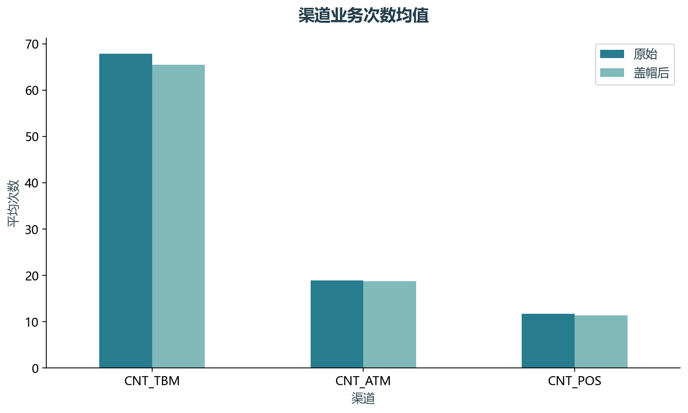
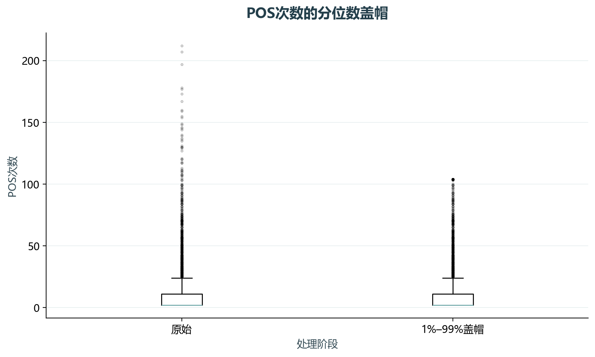

# 实验06 数据整合清洗

教材数据处理章节包含读取、拼接、去重、汇总和异常值处理。本实验用真实配套big.csv串成可运行的处理流程。

## 思路与参数

每块900行，拼接后按完整行去重；数值按1%和99%分位数盖帽。客户汇总用一对一连接检查，输出处理前后图和明细。

## Python转换

选取原笔记本单元3–4、50–53和93等内容，替换交互展示为CSV与PNG。原文件没有缺失时，审计如实记录0，不制造数据问题。

运行本目录的`python 实验.py`，或在商业数据分析根目录运行`python run_all.py --only 06`。输入取自同目录data，结果写入outputs。

## 实际结果

原表4500行，分5块读取。重复行0，数值缺失0格。盖帽用于演示预处理，并不意味着所有尾部业务记录都错误。

教材预处理练习；未人为制造缺失，盖帽的统计影响不等同于发现业务错误。

完整数值见[results.json](outputs/results.json)，中间表和预测结果见[outputs](outputs/)。

## 教材定位

来源：`CDA 教材资料2025.zip`。源文件路径及SHA-256见[全局来源清单](../../sources.json)。

原Notebook：`CDA 教材资料2025/2《CDA 二级认证教材：量化策略分析》/第4章- 数据处理(pandas)/第4章  数据整合和数据清洗.ipynb`。本实验选取上述核心内容转换与整理，没有将该Notebook未选部分算作已完成。

- `CDA 教材资料2025/2《CDA 二级认证教材：量化策略分析》/第4章- 数据处理(pandas)/data/big.csv`
