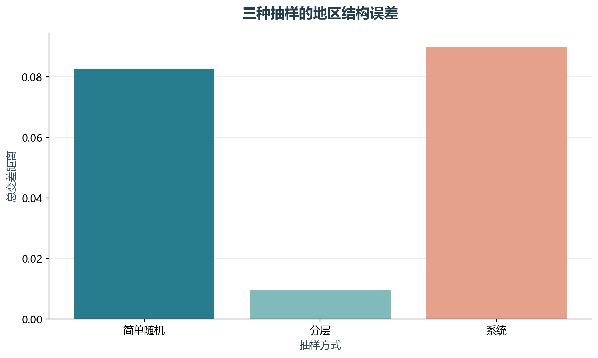
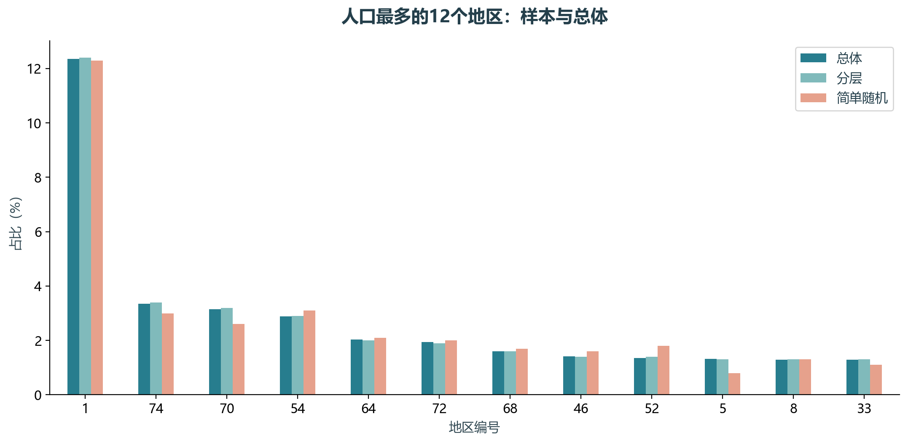

# 实验07 分层抽样

抽样后是否保持总体地区结构，是市场调研的基本检查。本实验对同一总体比较简单随机、分层和系统抽样。

## 思路与参数

样本1000，种子241，按Dist分层。按总体占比分配名额，最大余数法保证样本总量正确；总变差距离衡量地区比例差异。

## Python转换

依据原抽样函数与clients读取单元重构，修复字符串用is比较、种子不固定和比例取整导致数量偏差的问题。

运行本目录的`python 实验.py`，或在商业数据分析根目录运行`python run_all.py --only 07`。输入取自同目录data，结果写入outputs。

## 实际结果

从5369人抽取1000人。地区比例总变差距离分别为：简单随机0.0828、分层0.0096、系统0.0900；分层法在本次地区结构上更接近总体。

系统抽样对原始排序敏感，此处只展示本次固定顺序结果。

完整数值见[results.json](outputs/results.json)，中间表和预测结果见[outputs](outputs/)。

## 教材定位

来源：`CDA 教材资料2025.zip`。源文件路径及SHA-256见[全局来源清单](../../sources.json)。

原Notebook：`CDA 教材资料2025/2《CDA 二级认证教材：量化策略分析》/第6章-市场调研与数据预处理/1数据采集与处理 1 数据采集方法/抽样.ipynb`。本实验选取上述核心内容转换与整理，没有将该Notebook未选部分算作已完成。

- `CDA 教材资料2025/2《CDA 二级认证教材：量化策略分析》/第6章-市场调研与数据预处理/1数据采集与处理 1 数据采集方法/clients.csv`
