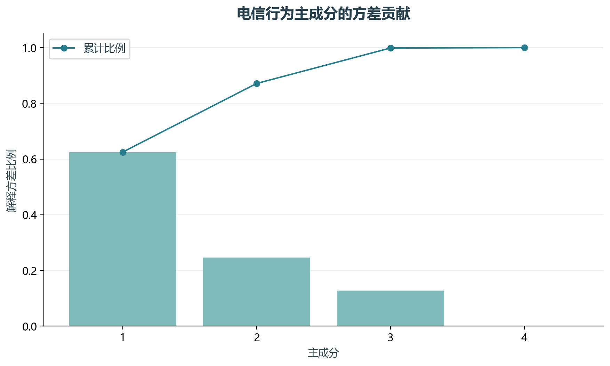
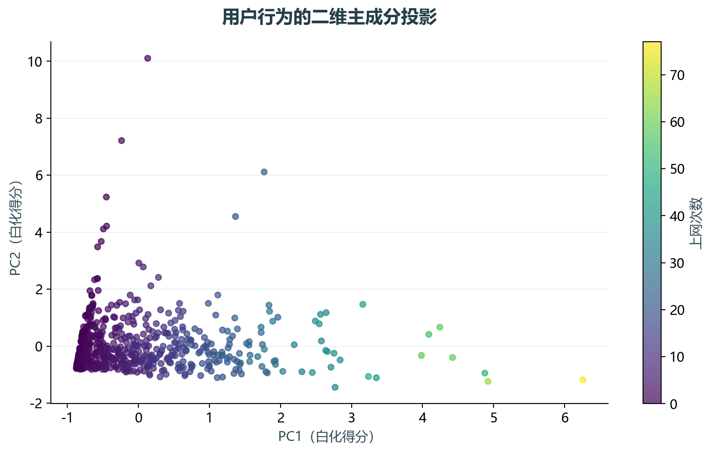

# 实验08 主成分分析

通话、短信、微信和上网次数的单位量级不同，直接比较会让大尺度变量主导。本实验以标准化PCA压缩四维行为信息。

## 思路与参数

对应原单元3–7，使用2个主成分并白化；完整PCA另用于展示累计解释方差。得分表与主成分系数分别保存。

## Python转换

移除Notebook显示依赖，转换为脚本函数。PCA轴正负号可以整体改变，系数符号不作为客户价值正负的直接依据。

运行本目录的`python 实验.py`，或在商业数据分析根目录运行`python run_all.py --only 08`。输入取自同目录data，结果写入outputs。

## 实际结果

600位用户的四维行为，前两个主成分合计解释87.13%的标准化方差，二维投影仍会损失其余信息。

PCA轴的正负号可整体翻转，不代表业务方向发生变化。

完整数值见[results.json](outputs/results.json)，中间表和预测结果见[outputs](outputs/)。

## 教材定位

来源：`CDA 教材资料2025.zip`。源文件路径及SHA-256见[全局来源清单](../../sources.json)。

原Notebook：`CDA 教材资料2025/2《CDA 二级认证教材：量化策略分析》/第7章-特征降维方法/在 Python 中实现主成分分析.ipynb`。本实验选取上述核心内容转换与整理，没有将该Notebook未选部分算作已完成。

- `CDA 教材资料2025/2《CDA 二级认证教材：量化策略分析》/第7章-特征降维方法/profile_telecom.csv`
