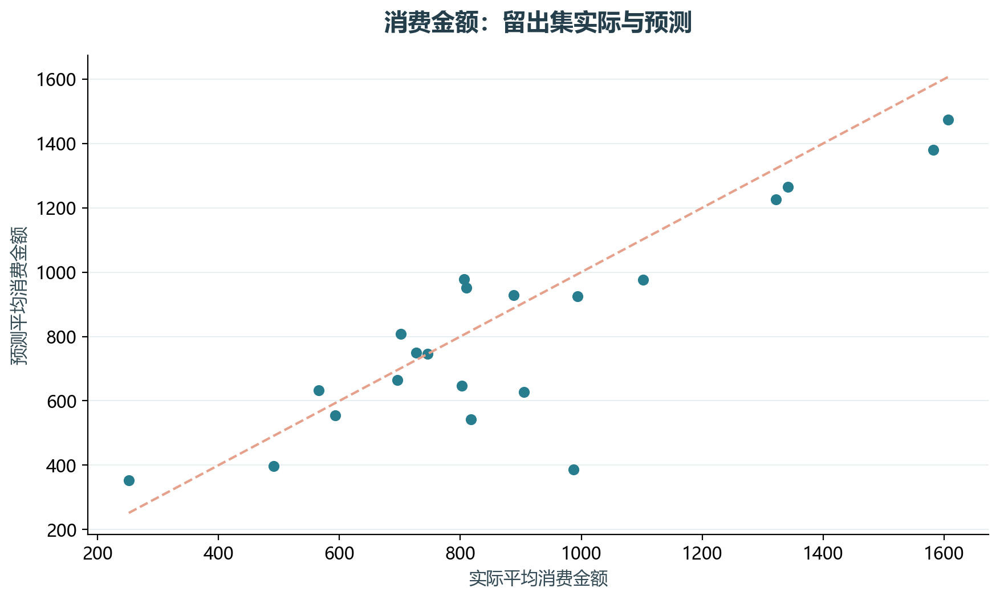
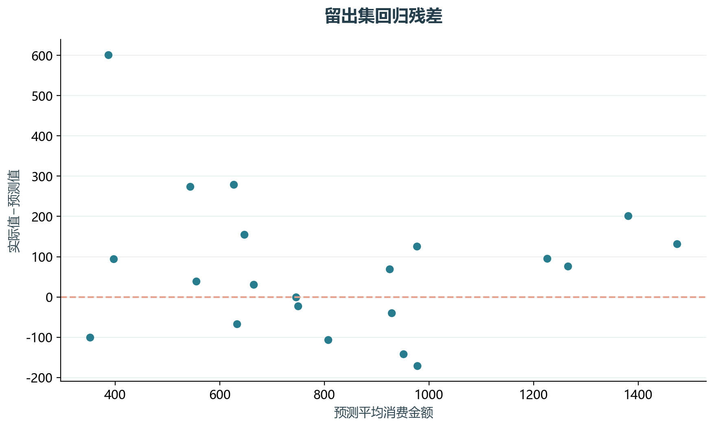

# 实验09 线性回归

消费金额与收入、年龄和居住特征的关系，用多元线性回归表达。本实验也检查留出集残差，避免只报告训练拟合。

## 思路与参数

选取原读取、清洗、虚拟变量与回归核心段。异常年龄999置为缺失；训练集学习填补与教育类别编码；按7:3留出。

## Python转换

以sklearn回归管道替代statsmodels交互式公式展示，保留消费金额回归问题。未把原笔记本所有逐步扩展模型都计为独立实验。

运行本目录的`python 实验.py`，或在商业数据分析根目录运行`python run_all.py --only 09`。输入取自同目录data，结果写入outputs。

## 实际结果

有效目标记录70条，训练49、测试21条。留出RMSE为185.25，R²为0.694。小样本划分结果不等于稳定的总体预测能力。

教材多元回归核心段转换；不把训练拟合优度当作留出预测能力。

完整数值见[results.json](outputs/results.json)，中间表和预测结果见[outputs](outputs/)。

## 教材定位

来源：`CDA 教材资料2025.zip`。源文件路径及SHA-256见[全局来源清单](../../sources.json)。

原Notebook：`CDA 教材资料2025/2《CDA 二级认证教材：量化策略分析》/第8章-使用统计学方法进行检验和预测/线性回归/线性回归.ipynb`。本实验选取上述核心内容转换与整理，没有将该Notebook未选部分算作已完成。

- `CDA 教材资料2025/2《CDA 二级认证教材：量化策略分析》/第8章-使用统计学方法进行检验和预测/线性回归/LR_practice.xlsx`
