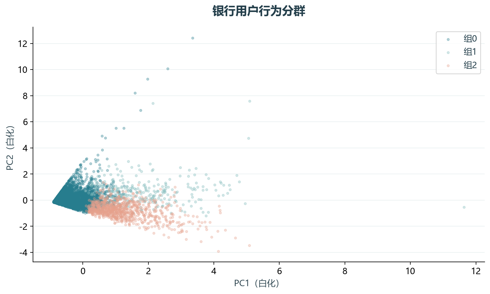
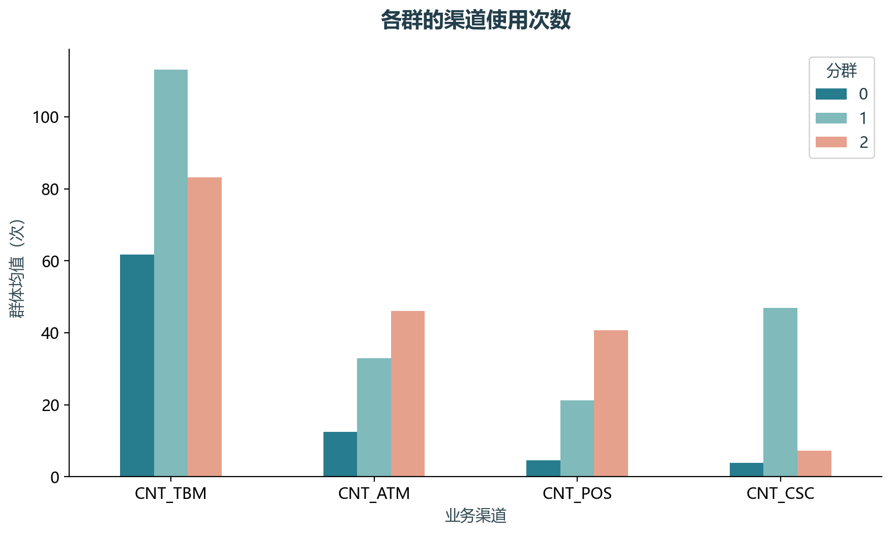

# 实验10 KMeans用户细分

银行客户可能依赖柜台、ATM、POS或信用卡渠道。使用多渠道行为分群，比按单一渠道排序更适合观察服务需求差异。

## 思路与参数

选取原单元0–3、13–24的核心流程；四个渠道计数先标准化，取3个白化主成分，再按教材设定分3群，固定初始化和种子。

## Python转换

用sklearn PCA替代旧因子得分库。完整样本用于计算，投影图固定抽至多5000点，轮廓系数固定抽2000点，避免图形和距离矩阵过大。

运行本目录的`python 实验.py`，或在商业数据分析根目录运行`python run_all.py --only 10`。输入取自同目录data，结果写入outputs。

## 实际结果

对100000位客户分3群，固定抽样轮廓系数为0.502。三主成分累计保留83.61%方差；渠道均值表用于判断各组差别。

保留教材3群设定；PCA近似旧因子得分，不声称标签逐个一致。

完整数值见[results.json](outputs/results.json)，中间表和预测结果见[outputs](outputs/)。

## 教材定位

来源：`CDA 教材资料2025.zip`。源文件路径及SHA-256见[全局来源清单](../../sources.json)。

原Notebook：`CDA 教材资料2025/2《CDA 二级认证教材：量化策略分析》/第9章-用户分群/k-means聚类/Kmeans 的应用 - 用户细分.ipynb`。本实验选取上述核心内容转换与整理，没有将该Notebook未选部分算作已完成。

- `CDA 教材资料2025/2《CDA 二级认证教材：量化策略分析》/第9章-用户分群/k-means聚类/profile_bank.csv`
