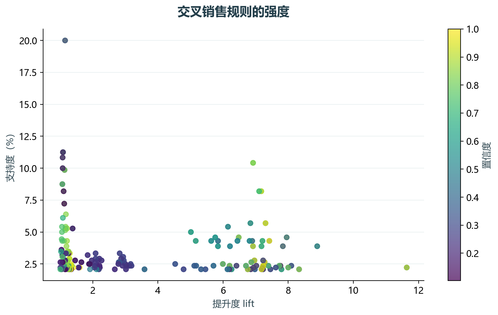
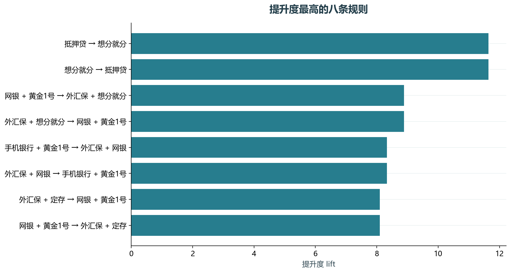

# 实验11 银行交叉销售关联规则

一个客户购买多种银行产品，就形成一个购物篮。关联规则寻找共现强于独立情况下预期的产品组合，用作交叉销售线索。

## 思路与参数

对应原单元1–7；支持度至少2%，置信度大于10%，提升度大于1。购物篮内同一产品去重，支持度分母为客户篮数。

## Python转换

用集合和候选剪枝实现Apriori，替代教材外部脚本与Orange旧库。枚举符合条件的频繁项集及其规则，不仅计算两两相关。

运行本目录的`python 实验.py`，或在商业数据分析根目录运行`python run_all.py --only 11`。输入取自同目录data，结果写入outputs。

## 实际结果

720个客户购物篮、21种产品，共得到302条满足阈值的规则，最高提升度为11.64。规则尚未经过营销试验验证。

同一客户重复购买同一产品只记一次；关联规则不代表购买因果关系。

完整数值见[results.json](outputs/results.json)，中间表和预测结果见[outputs](outputs/)。

## 教材定位

来源：`CDA 教材资料2025.zip`。源文件路径及SHA-256见[全局来源清单](../../sources.json)。

原Notebook：`CDA 教材资料2025/3《CDA 三级认证教材：敏捷数据挖掘》/2.4交叉销售（关联规则与序列模式）/2.4.1.关联规则（银行产品交叉销售分析）.ipynb`。本实验选取上述核心内容转换与整理，没有将该Notebook未选部分算作已完成。

- `CDA 教材资料2025/3《CDA 三级认证教材：敏捷数据挖掘》/2.4交叉销售（关联规则与序列模式）/bank_prod_order.csv`
