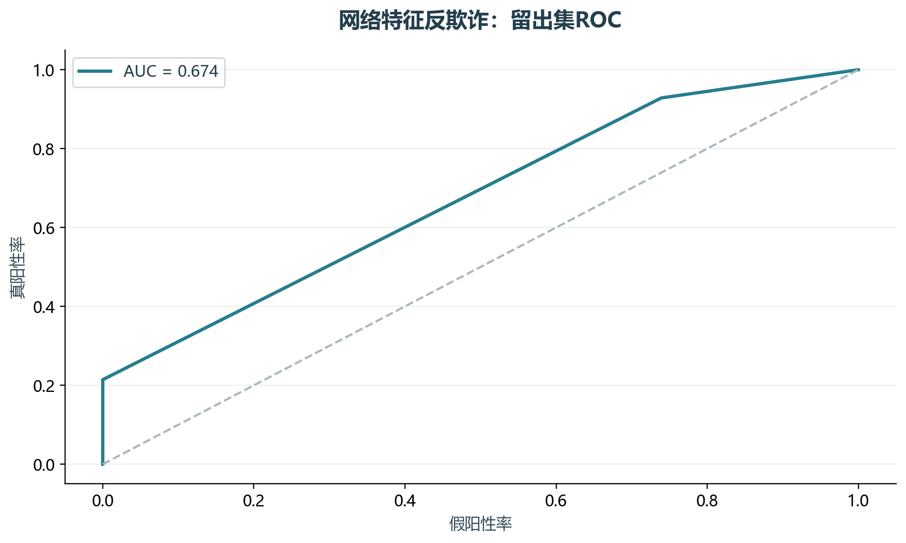
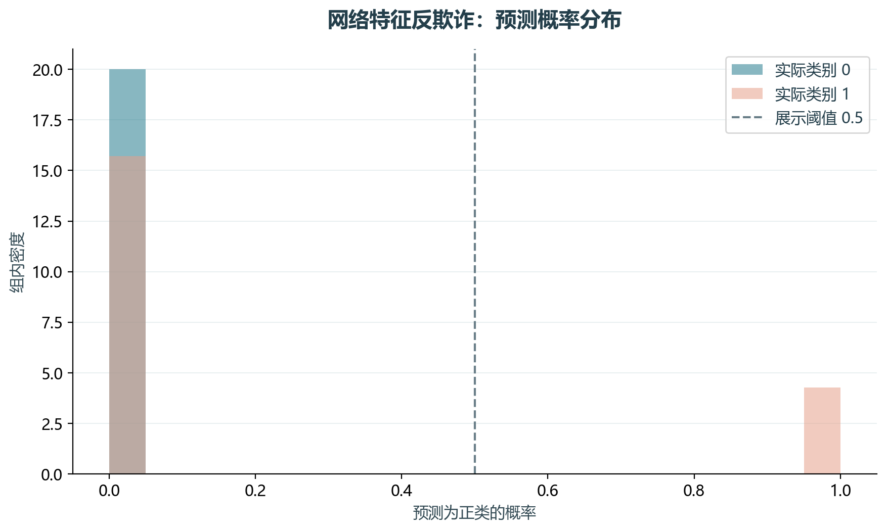

# 实验12 申请反欺诈分类

教材以网络规模、度、邻居度和比例识别异常申请。本实验选取决策树部分，观察分裂参数及留出表现。

## 思路与参数

对应原单元0–2及决策树评估段；60%训练、40%分层测试，训练内4折比较深度2–5和叶节点最小样本5/20/50，按AUC选型。

## Python转换

将长Notebook压缩为可运行的训练、参数比较和测试流程。XGBoost、LightGBM等扩展模型不属于本次所选实验范围。

运行本目录的`python 实验.py`，或在商业数据分析根目录运行`python run_all.py --only 12`。输入取自同目录data，结果写入outputs。

## 实际结果

留出集10929条、正类28条，ROC AUC为0.674，AP为0.217；固定0.5阈值下精确率100.00%、召回率21.43%。

精选决策树核心实验，未运行原笔记本全部集成模型；评估限于教材样本。

完整数值见[results.json](outputs/results.json)，中间表和预测结果见[outputs](outputs/)。

## 教材定位

来源：`CDA 教材资料2025.zip`。源文件路径及SHA-256见[全局来源清单](../../sources.json)。

原Notebook：`CDA 教材资料2025/3《CDA 三级认证教材：敏捷数据挖掘》/3.1申请反欺诈（决策树系列等）/3.1.1-3.1.2分类（反欺诈_DT_EnsembleMethods）.ipynb`。本实验选取上述核心内容转换与整理，没有将该Notebook未选部分算作已完成。

- `CDA 教材资料2025/3《CDA 三级认证教材：敏捷数据挖掘》/3.1申请反欺诈（决策树系列等）/loan_net.csv`
