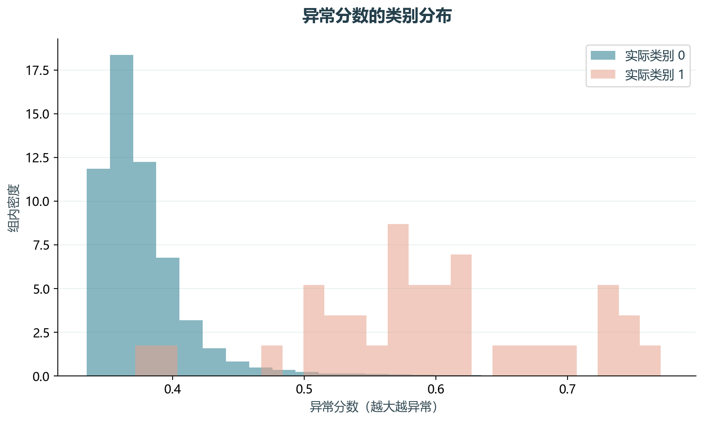
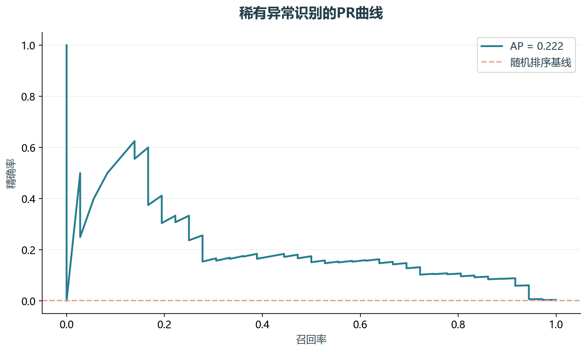

# 实验13 异常交易识别

孤立森林不需要训练标签，借助异常点较容易被分割的特点识别可疑交易。这里的Class仅用于分层留出及事后评价。

## 思路与参数

选取原单元0–6。原284807条按Class比例分层抽60000条，固定种子241；训练65%，测试35%。100棵树，固定2%异常预算，不用测试标签调参。

## Python转换

保留V1–V28特征和孤立森林思路，加入独立留出和PR评价。未运行原LOF与基于标签的随机搜索；稀有正类使单次评估存在明显波动。

运行本目录的`python 实验.py`，或在商业数据分析根目录运行`python run_all.py --only 13`。输入取自同目录data，结果写入outputs。

## 实际结果

发布子样本60000条，欺诈104条；测试中只有36条欺诈。测试ROC AUC为0.976，AP为0.222，固定预算下召回率91.67%。

原284807条数据按Class分层抽60000条，保持类别比例；种子241。固定2%异常预算不等于真实欺诈率。

完整数值见[results.json](outputs/results.json)，中间表和预测结果见[outputs](outputs/)。

## 教材定位

来源：`CDA 教材资料2025.zip`。源文件路径及SHA-256见[全局来源清单](../../sources.json)。

原Notebook：`CDA 教材资料2025/3《CDA 三级认证教材：敏捷数据挖掘》/3.2违规识别（孤立森林、局部异常因子）/3.2违规识别(IsolationForrest_LOF无监督).ipynb`。本实验选取上述核心内容转换与整理，没有将该Notebook未选部分算作已完成。

- `CDA 教材资料2025/3《CDA 三级认证教材：敏捷数据挖掘》/3.2违规识别（孤立森林、局部异常因子）/creditcard.csv`
