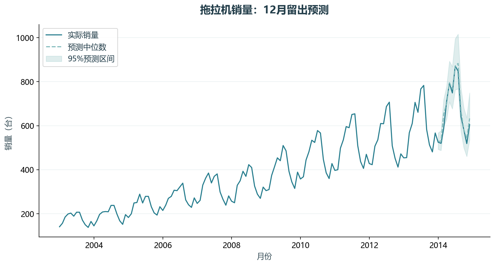
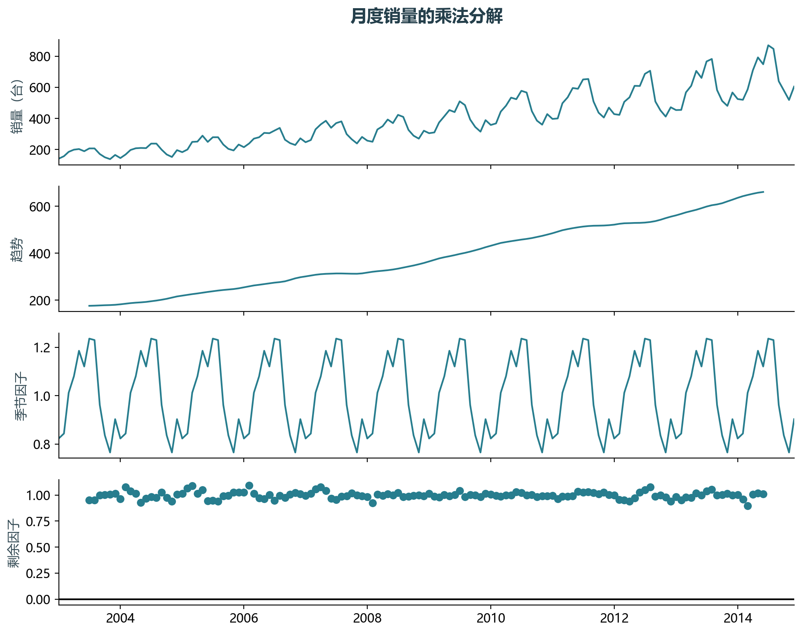

# 实验14 SARIMA销量预测

拖拉机销量存在年度季节性，SARIMA同时描述短期依赖、差分和12个月周期。最后一年留出用于检验外推。

## 思路与参数

对应原单元2–11、15–16；训练期内比较3个低阶候选的AIC，丢弃未收敛候选。最后12个月不参与选型，输出95%预测区间与误差。

## Python转换

将64组全量搜索改为明确的小候选集，修正预测日期重叠。对数尺度均值取exp后标为原尺度中位数，避免混用均值与中位数。

运行本目录的`python 实验.py`，或在商业数据分析根目录运行`python run_all.py --only 14`。输入取自同目录data，结果写入outputs。

## 实际结果

销量共144个月，最后12个月留出。RMSE为25.65台，MAPE为2.90%，去年同期RMSE为71.15台；95%区间覆盖率91.67%。

exp(对数预测均值)在原尺度是中位数；修正原笔记本预测日期从最后观测月重复开始的问题。

完整数值见[results.json](outputs/results.json)，中间表和预测结果见[outputs](outputs/)。

## 教材定位

来源：`CDA 教材资料2025.zip`。源文件路径及SHA-256见[全局来源清单](../../sources.json)。

原Notebook：`CDA 教材资料2025/3《CDA 三级认证教材：敏捷数据挖掘》/4.1时间序列预测/4.1.2销售数据预测(SARIMA).ipynb`。本实验选取上述核心内容转换与整理，没有将该Notebook未选部分算作已完成。

- `CDA 教材资料2025/3《CDA 三级认证教材：敏捷数据挖掘》/4.1时间序列预测/tractor_sales.csv`
