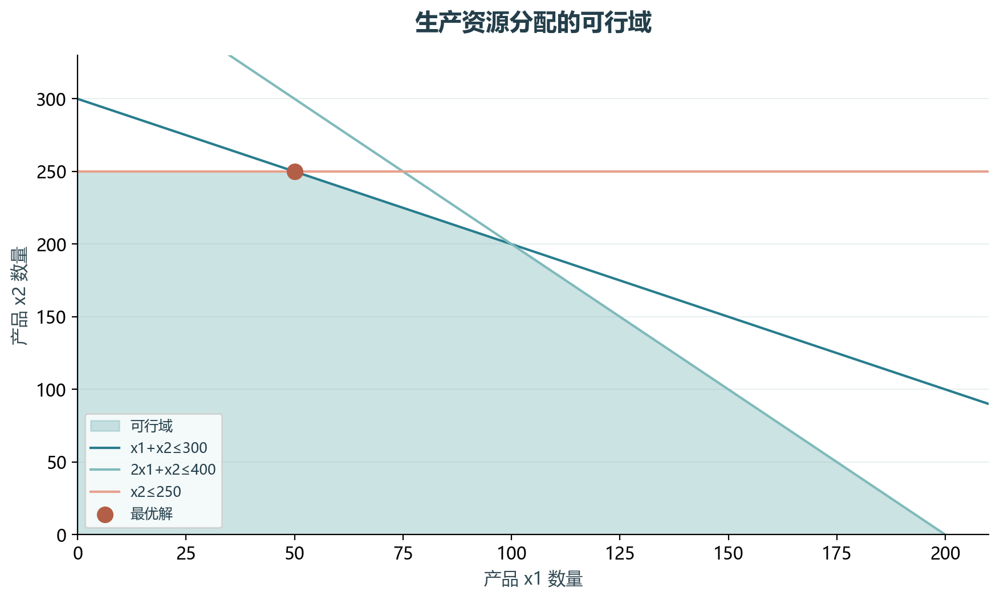
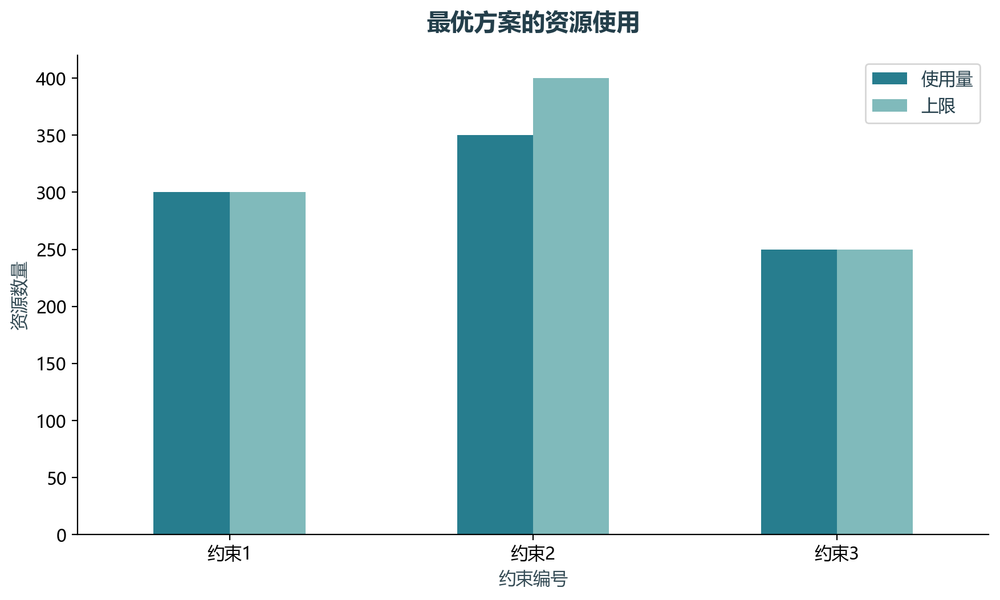

# 实验15 线性规划资源分配

两个产品共享三项资源，目标是在资源上限内最大化利润。实验把教材lp模型转换成明确的目标向量和约束矩阵。

## 思路与参数

原模型为max 50x1+100x2，约束x1+x2≤300、2x1+x2≤400、x2≤250，变量非负；沿用连续线性规划设定。

## Python转换

Notebook原单元6–13依赖CPLEX读取productivity.lp，改用SciPy HiGHS。原lp文件保留，解的可行性、目标值和约束余量均有断言。

运行本目录的`python 实验.py`，或在商业数据分析根目录运行`python run_all.py --only 15`。输入取自同目录data，结果写入outputs。

## 实际结果

最优解为x1=50、x2=250，目标值27500。第二项约束仍有50单位余量，其他两项约束达到上限。

教材模型是连续线性规划，不额外声称存在整数批量或现实生产约束。

完整数值见[results.json](outputs/results.json)，中间表和预测结果见[outputs](outputs/)。

## 教材定位

来源：`CDA 教材资料2025.zip`。源文件路径及SHA-256见[全局来源清单](../../sources.json)。

原Notebook：`CDA 教材资料2025/3《CDA 三级认证教材：敏捷数据挖掘》/4.2运筹优化/4.2.1线性规划.ipynb`。本实验选取上述核心内容转换与整理，没有将该Notebook未选部分算作已完成。

- `CDA 教材资料2025/3《CDA 三级认证教材：敏捷数据挖掘》/4.2运筹优化/productivity.lp`
