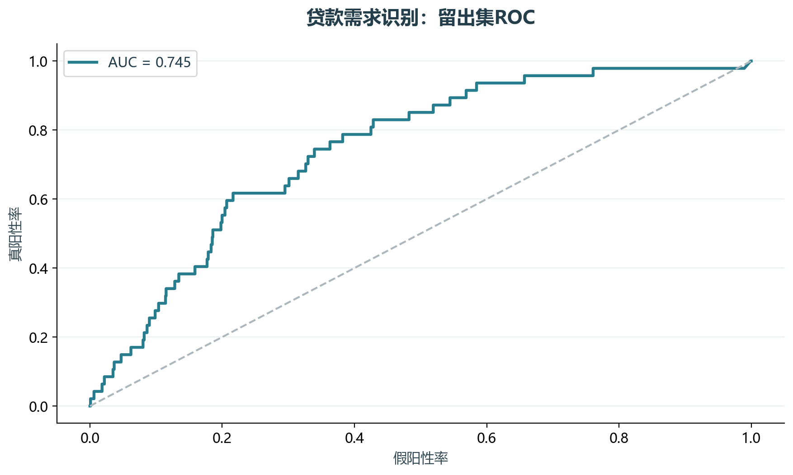
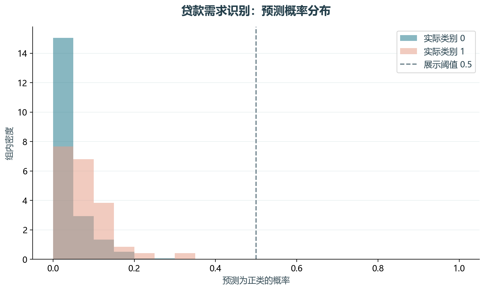

# 实验16 贷款精准营销

贷款精准营销不是预测已知贷款状态。本实验只使用教材公式中的余额、余额变动、支出和卡片变量识别需求倾向。

## 思路与参数

对应原单元28、34、36–42；训练内学习1%/99%截点、填补与标准化，70%训练、30%分层测试。固定0.5阈值只作展示，不据测试集优化阈值。

## Python转换

保留逻辑回归主线，排除loan_date/status/amount等可能泄露标签的字段。pred0917包含同账户的历史快照，故只称待评分文件。

运行本目录的`python 实验.py`，或在商业数据分析根目录运行`python run_all.py --only 16`。输入取自同目录data，结果写入outputs。

## 实际结果

留出集1193条、正类47条，ROC AUC为0.745，AP为0.102；固定0.5阈值下精确率0.00%、召回率0.00%。 此阈值没有检出正类，不能据此宣称模型已经适合业务使用；若继续调阈值，应另设验证集。

客户内的历史快照可能重复出现在待评分文件，故不把该文件称为独立外部测试集。排序是教学示范。

完整数值见[results.json](outputs/results.json)，中间表和预测结果见[outputs](outputs/)。

## 教材定位

来源：`CDA 教材资料2025.zip`。源文件路径及SHA-256见[全局来源清单](../../sources.json)。

原Notebook：`CDA 教材资料2025/4《金融数据分析和数据挖掘案例实战》/第2章-某银行贷款产品精准营销模型/第二章某银行贷款产品精准营销模型代码通过.ipynb`。本实验选取上述核心内容转换与整理，没有将该Notebook未选部分算作已完成。

- `CDA 教材资料2025/4《金融数据分析和数据挖掘案例实战》/第2章-某银行贷款产品精准营销模型/tran0917.csv`
- `CDA 教材资料2025/4《金融数据分析和数据挖掘案例实战》/第2章-某银行贷款产品精准营销模型/pred0917.csv`
