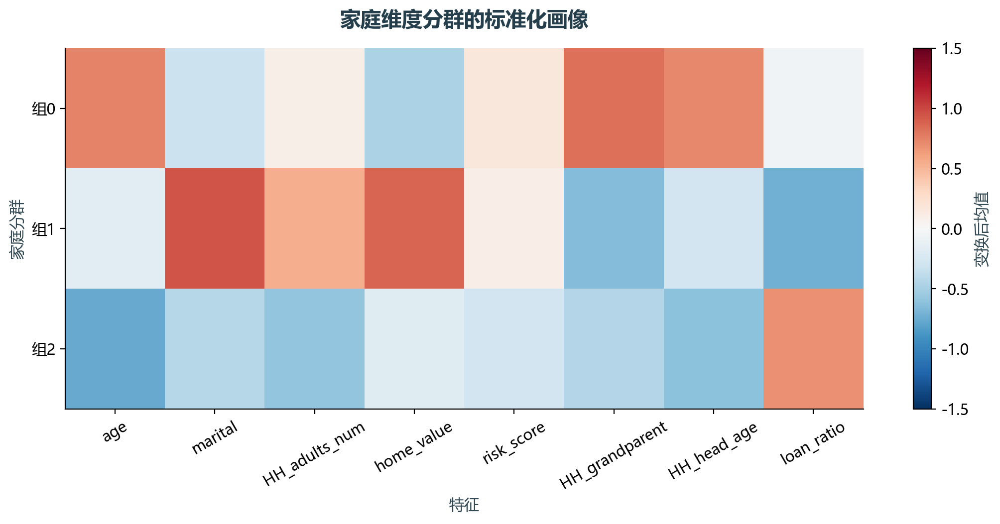
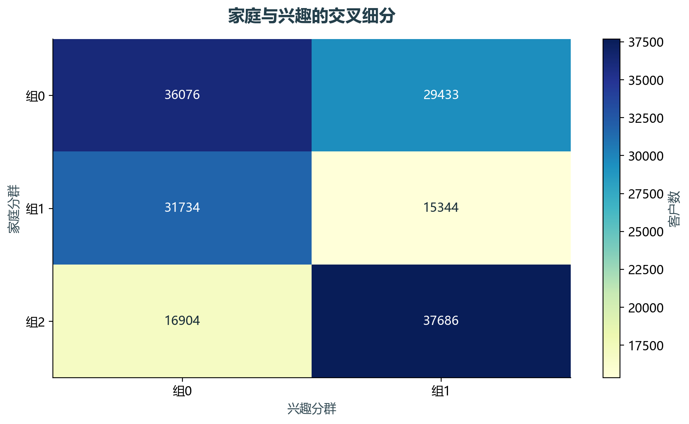

# 实验17 多维客户细分

家庭特征和兴趣特征回答不同的分群问题。本实验分别降维，再把两个分群结果交叉为更细的客户画像。

## 思路与参数

对应原单元9–21、23–34；修订缺失和错误编码，家庭取4因子/3群，兴趣取3因子/2群。使用varimax旋转，固定随机种子。

## Python转换

用sklearn旋转因子替换旧库，特征统一做分位数与标准化处理。采用精确SVD，每样本对数似然改变量阈值1e-5，检查迭代收敛。标签数字没有固定业务名称，解释以输出的群体均值为依据。

运行本目录的`python 实验.py`，或在商业数据分析根目录运行`python run_all.py --only 17`。输入取自同目录data，结果写入outputs。

## 实际结果

处理167177位客户，家庭3组、兴趣2组形成交叉细分。家庭因子空间的抽样轮廓系数为0.194；应结合均值画像解释，不能只按编号命名高低价值。

sklearn旋转因子替代旧FactorAnalysis库；保留家庭4因子/3群、兴趣3因子/2群框架，标签不要求与教材逐一相同。

完整数值见[results.json](outputs/results.json)，中间表和预测结果见[outputs](outputs/)。

## 教材定位

来源：`CDA 教材资料2025.zip`。源文件路径及SHA-256见[全局来源清单](../../sources.json)。

原Notebook：`CDA 教材资料2025/4《金融数据分析和数据挖掘案例实战》/第3章-多维特征的客户细分/第3章多维特征的客户细分代码通过.ipynb`。本实验选取上述核心内容转换与整理，没有将该Notebook未选部分算作已完成。

- `CDA 教材资料2025/4《金融数据分析和数据挖掘案例实战》/第3章-多维特征的客户细分/data_clust.csv`
