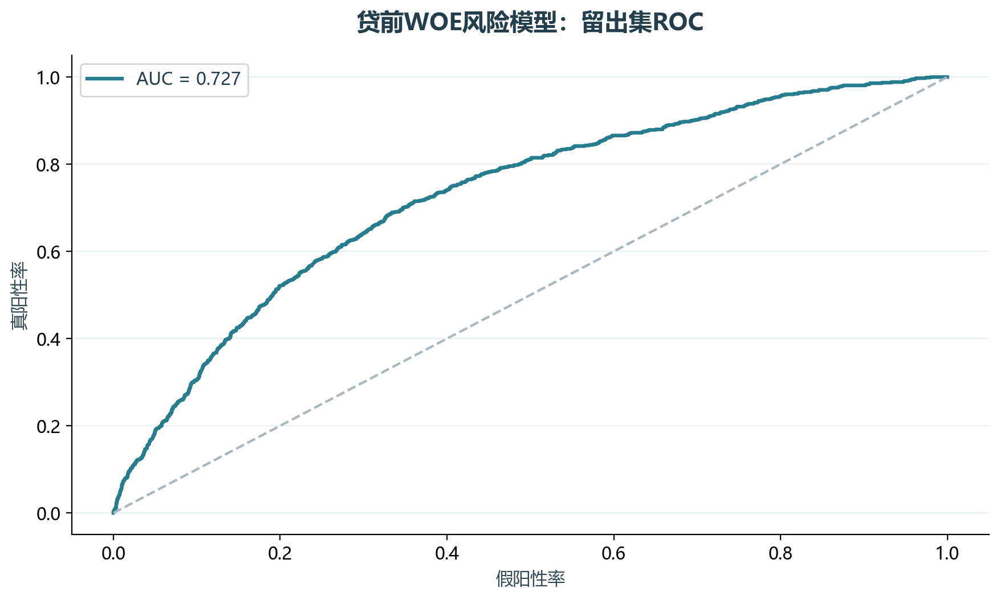
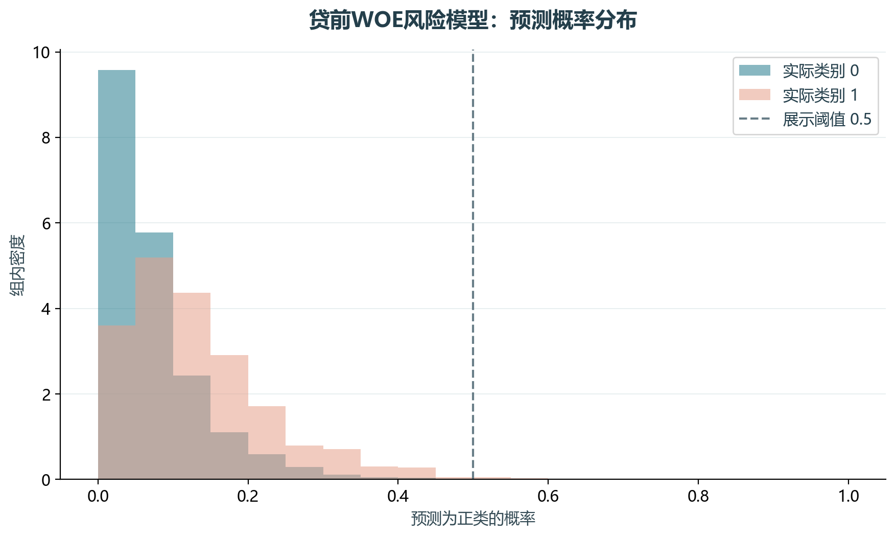

# 实验18 贷前信用风险

贷前风险实验用分箱WOE把变量转换为好坏样本对比，再通过逻辑回归形成风险概率与教学信用分。

## 思路与参数

对应原单元13–43、57；训练67%，测试33%。训练五分位分箱、0.5平滑、IV≥0.02、相关系数≤0.7，最多12个变量；基准分600、好坏比35、PDO50。

## Python转换

用透明的Pandas分箱与WOE替代toad决策树分箱和逐步回归。保留评分卡逻辑，系数不声称与原教材一致；缺失率过滤与变量筛选都只使用训练集。

运行本目录的`python 实验.py`，或在商业数据分析根目录运行`python run_all.py --only 18`。输入取自同目录data，结果写入outputs。

## 实际结果

留出集9900条、正类783条，ROC AUC为0.727，AP为0.188；固定0.5阈值下精确率42.86%、召回率0.38%。

以训练集五分位箱替代教材toad决策树分箱与逐步回归，保留WOE评分卡逻辑；不是复现同一组最优系数，不用于真实授信。

完整数值见[results.json](outputs/results.json)，中间表和预测结果见[outputs](outputs/)。

## 教材定位

来源：`CDA 教材资料2025.zip`。源文件路径及SHA-256见[全局来源清单](../../sources.json)。

原Notebook：`CDA 教材资料2025/4《金融数据分析和数据挖掘案例实战》/第5章-贷前信用风险预测模型（A卡）/第5章贷前信用风险预测模型（A卡）代码通过.ipynb`。本实验选取上述核心内容转换与整理，没有将该Notebook未选部分算作已完成。

- `CDA 教材资料2025/4《金融数据分析和数据挖掘案例实战》/第5章-贷前信用风险预测模型（A卡）/creditdata_small.csv`
