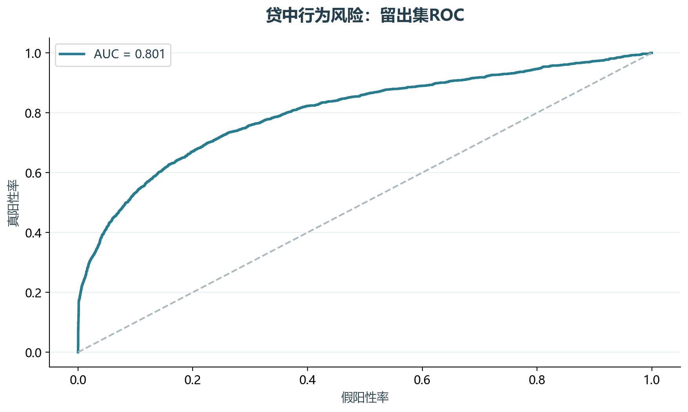
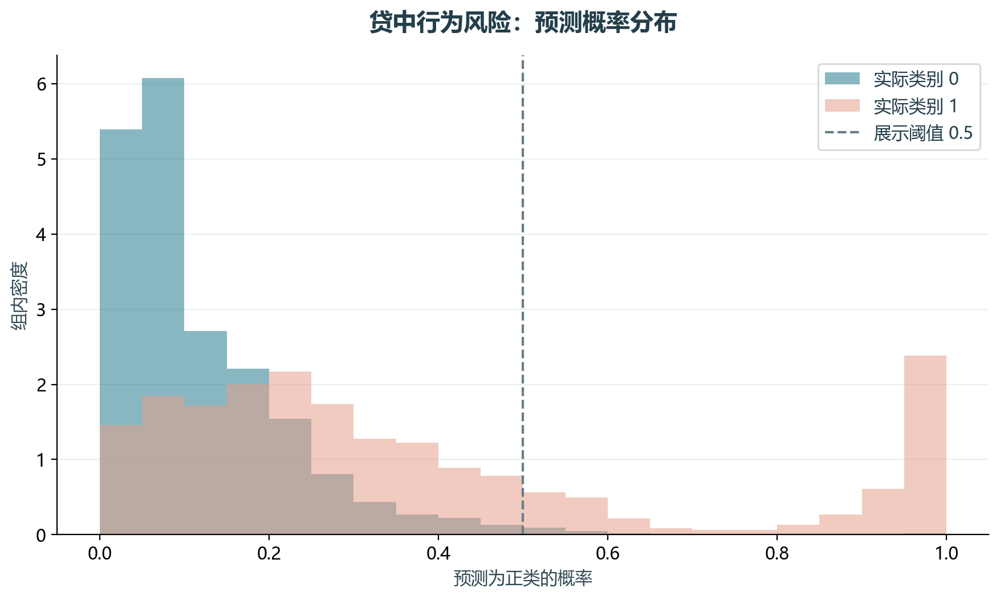

# 实验19 贷中行为风险

同一客户可能有多个信用卡账户，账期行不是独立客户。本实验从还款、逾期和额度使用聚合3、6、12个月行为宽表。

## 思路与参数

对应原单元13–21、29、40；账户额度按复合键合并，目标按客户取账户标签最大值。客户粒度67%/33%分层留出，填补和标准化只学训练集。

## Python转换

修正原循环可能给之前窗口重复追加后缀的问题；本次选取聚合特征与逻辑回归，不重复扩展WOE评分卡。缺少标签实际时间说明，不将客户留出称为时间外验证。

运行本目录的`python 实验.py`，或在商业数据分析根目录运行`python run_all.py --only 19`。输入取自同目录data，结果写入outputs。

## 实际结果

留出集13247条、正类2135条，ROC AUC为0.801，AP为0.566；固定0.5阈值下精确率81.28%、召回率24.40%。

精选还款/逾期/额度聚合与逻辑回归，未使用toad。教材未提供标签实际起止日期，当前是客户留出验证，不宣称时间外泛化。

完整数值见[results.json](outputs/results.json)，中间表和预测结果见[outputs](outputs/)。

## 教材定位

来源：`CDA 教材资料2025.zip`。源文件路径及SHA-256见[全局来源清单](../../sources.json)。

原Notebook：`CDA 教材资料2025/4《金融数据分析和数据挖掘案例实战》/第6章-贷中信用风险预测模型（B卡）/第6章贷中信用风险预测模型（B卡）代码通过.ipynb`。本实验选取上述核心内容转换与整理，没有将该Notebook未选部分算作已完成。

- `CDA 教材资料2025/4《金融数据分析和数据挖掘案例实战》/第6章-贷中信用风险预测模型（B卡）/Data/CreditBalance.csv`
- `CDA 教材资料2025/4《金融数据分析和数据挖掘案例实战》/第6章-贷中信用风险预测模型（B卡）/Data/label.csv`
