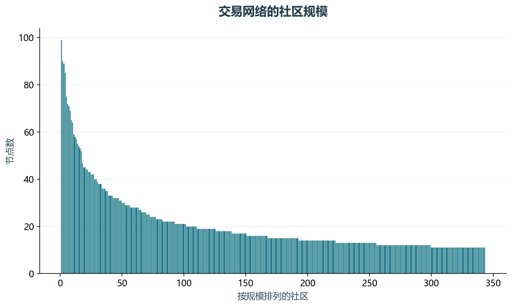
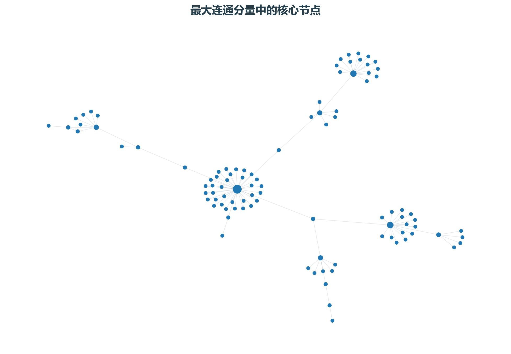

# 实验20 银行交易网络

交易关系可构成网络。社区表示连接相对密集的节点集合，PageRank与度数则描述不同的结构位置。

## 思路与参数

对应原单元2–12；保留教材无向关系，去重及去自环，全图计算Louvain、模块度和PageRank。绘图只展示最大连通分量中度数前120的诱导子图。

## Python转换

用NetworkX内置Louvain替代python-louvain旧接口，固定布局和社区种子。网络社区不直接等同于欺诈团伙。

运行本目录的`python 实验.py`，或在商业数据分析根目录运行`python run_all.py --only 20`。输入取自同目录data，结果写入outputs。

## 实际结果

全图7059个节点、6903条边，存在343个连通分量；最大分量仅99个节点。Louvain划分343个社区，模块度0.996。高模块度也受网络碎片化影响，不能直接解释为很强的业务分群质量。网络图展示99个核心节点，统计指标仍来自全图。

全图计算社区与PageRank，网络图仅展示最大连通分量中度数前120的诱导子图；不把社区直接标记为欺诈团伙。

完整数值见[results.json](outputs/results.json)，中间表和预测结果见[outputs](outputs/)。

## 教材定位

来源：`CDA 教材资料2025.zip`。源文件路径及SHA-256见[全局来源清单](../../sources.json)。

原Notebook：`CDA 教材资料2025/4《金融数据分析和数据挖掘案例实战》/补充-社交网络/05-社交网络—银行交易圈实践-社区发现 .ipynb`。本实验选取上述核心内容转换与整理，没有将该Notebook未选部分算作已完成。

- `CDA 教材资料2025/4《金融数据分析和数据挖掘案例实战》/补充-社交网络/data/Archive-社交网络-交易对手明细汇总.csv`
