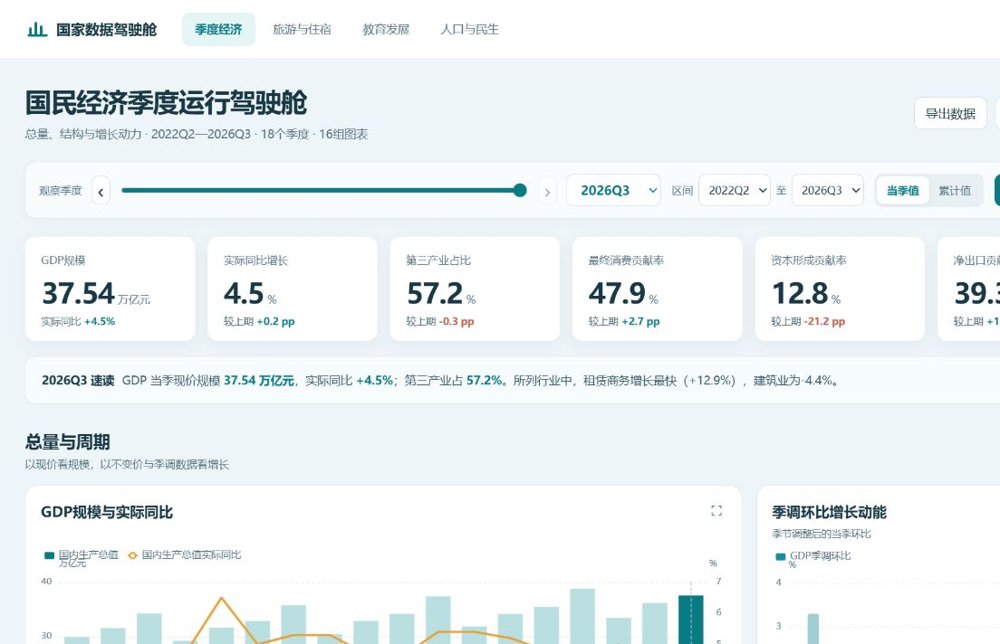

# 国家数据四主题可视化看板

曹俊男 · 2024459985112 · 大数据241 · 数据科学学院

四个可独立打开、相互导航的大型交互看板，共64组图表、23种图形。使用国家统计局国家数据公开表，Python负责整理与核验，ECharts负责浏览器内的交互呈现。



完整长图：[季度经济](outputs/previews/economy-desktop.jpg) · [旅游住宿](outputs/previews/tourism-desktop.jpg) · [教育发展](outputs/previews/education-desktop.jpg) · [人口民生](outputs/previews/population-desktop.jpg)。手机截图保存在同一目录。

## 打开成果

下载整个文件夹或解压[完整交付包](releases/国家数据四主题看板.zip)，打开 **index.html**。请保留 assets、dashboards 与入口文件的相对位置。查看不需要安装Python，也不需要登录国家数据网站。GitHub文件预览不能运行HTML，应先下载。

|主题|独立入口|观察范围|内容|
|---|---|---|---|
|国民经济季度运行|[economy.html](dashboards/economy.html)|2022Q2—2026Q3，18个季度|GDP、季调环比、三次产业、增长贡献、行业分化与季度节奏|
|全国旅游与住宿|[tourism.html](dashboards/tourism.html)|2011—2025|国内出游、花费、入出境、国际收入、客源、旅行社及星级饭店|
|全国教育发展|[education.html](dashboards/education.html)|2011—2025|六类学段、招生毕业、学校教师、资源配置、全国教育经费|
|人口与居民生活|[population.html](dashboards/population.html)|2011—2025|人口、年龄、抚养、城镇化、收入来源、消费和城乡差异|

每主题16图。观察范围表示时间轴范围，不表示每项指标都有全部年份。饭店和教育经费等指标的最新公布年会单独标记；客源国家明细最近可用年为2018年，国际收入构成最近可用年为2019年。

## 交互操作

- 拖动时间轴、使用左右箭头或选择观察期，指标、排名与结构图同步更新。
- 设置区间起止，趋势、同比矩阵与相关分析同步缩放。观察期自动限制在所选区间内。
- 点击时间序列柱体、折线数据点或同比矩阵单元格，可以切换观察期；非时间分类图保留本身的结构交互。
- 季度经济支持当季与累计切换；季调环比、季度轮廓和规模差额始终使用当季数据。
- 教育看板支持学段筛选。全国教育经费图不随学段重算，学前教育没有同口径招生毕业数据时显示空状态。
- 播放会逐期推进，到区间末尾停止。重置恢复默认观察期、全区间与全部学段。
- 图例可隐藏或恢复系列，悬停查看明细；右上角图标可放大单图并保存PNG。
- “导出数据”导出所选时间区间，“导出当前期”导出当前观察期。CSV保留数值精度和空值；教育导出同时保留各学段原序列与所选学段合计。
- 数据来源及统计口径集中在“数据口径”窗口。顶部提供全屏按钮，浏览器不支持时可使用F11。

## 数据与方法

查询入口：[国家统计局国家数据](https://data.stats.gov.cn/dg/website/page.html#/pc/national/home)。采集日期：2026年11月19日。

原始资料包括31份公开查询表格的DOM快照JSON，以及登录后通过官方页面下载的国内旅游Excel。JSON保存公开表头、指标、原始文本和空白，属于查询快照，不冒充官方Excel导出。国内旅游表的135个单元格已与官方Excel逐格核对一致。文件校验值、来源网址、访问日期与采集方式见 data/raw/source_manifest.json。

标准化长表包含420个原始指标、6,507个单元格，其中4,064个有效观测、2,443个缺失。空白不补零，不插值。季度与年度分开分析，金额和人次转换为适合展示的单位。看板中的每条序列均保存源表、源指标及转换系数，计算指标保存依赖字段。

项目使用组合图、堆叠柱图、堆叠面积、百分比面积、折线、排名条形、矩形树、环形、南丁格尔玫瑰、热力矩阵、气泡散点、平行坐标、蝴蝶、斜率、滑珠、雷达、瀑布与基期指数等图形，结合同比、占比、结构差异和Pearson相关分析。64组图表清单见 outputs/chart_catalog.csv。

需要区分的口径：

- 现价GDP用于规模，不变价指数减100用于实际同比；累计值直接取官方表，不对季度增速求平均。增长贡献率可为负或大于100%。
- 国内游客、入境游客与出境游客均为人次，不等于去重人数。入境减出境仅为出行人次差，不代表人口迁移或旅游收支。
- 2014年国际旅游收入发生统计方法与口径调整，该年跨口径同比留空。依据：[中国旅游研究院对2014年公报修订的说明](https://www.ctaweb.org.cn/tongzhigonggao/8007.html)。
- “列示国家”仅指原表列出的客源国家，不能当作全球全部国家分布。星级饭店数量不代表所有酒店、民宿及旅馆数量。
- 教育的六类合计不包含中职、研究生和成人教育，不能当作全国全部在校生。不同学段学校数不合计为去重校园数；学生/教师是数量比，并非官方调整后的生师比。
- 教育经费覆盖全国教育，不能除以六类学段学生数得出生均经费。2020年总投入与来源分类之和相差0.0061亿元，保留原表精度，不强行配平。
- 居民收支使用本次公开表，包括其2011、2012年历史值，不自行拼接旧表。收入与消费均为名义人均金额；人口出生、死亡与自然增长率单位为‰。
- 同比使用相邻年份，基期指数使用指定基年。相关系数仅使用共同有效观测，样本量在提示框显示；共同趋势可能造成高相关，不能解释为因果。

## 复现

建议使用Python3.11及以上版本，在项目目录运行：

```powershell
python -m pip install -r requirements.txt
python run_all.py
```

流程是原始快照规范化、四主题指标构建、生成离线HTML、自动核验。复现从已归档原始文件开始，不自动登录网站，也不依赖在线接口。更新源数据后需重新运行；本项目不是实时数据服务。

本次实际使用Python3.12.14完成构建。若需要重新打包，在构建通过后执行 `python scripts/05_package.py`；它会核对压缩包CRC和逐文件SHA256，并生成独立交付副本，不删除原文件。

也可使用本地HTTP服务预览：

```powershell
python -m http.server 8876 --bind 127.0.0.1
```

浏览器访问 http://127.0.0.1:8876 。

## 文件结构

```text
index.html                 统一入口，默认季度经济
dashboards/                四个独立主题页面
assets/                    本地ECharts、共享脚本和样式
data/raw/                  原始查询快照、官方Excel及来源清单
data/clean/                标准长表、SQLite、四主题数据与数据字典
scripts/                   四步Python流水线、HTML模板、打包脚本
run_all.py                 一键复现
outputs/                   图表目录、数据核验、浏览器检查与预览截图
docs/                      操作与分析说明
releases/                  完整项目ZIP，不含嵌套ZIP
```

本作业与仓库中既有的可视化复刻、商业数据分析实验及杭州期末项目分开放置。第三方图表库与许可见 THIRD_PARTY.md。检查范围、已知限制见 outputs/browser_qa.json；数据自动核验结果见 outputs/verification.json。
